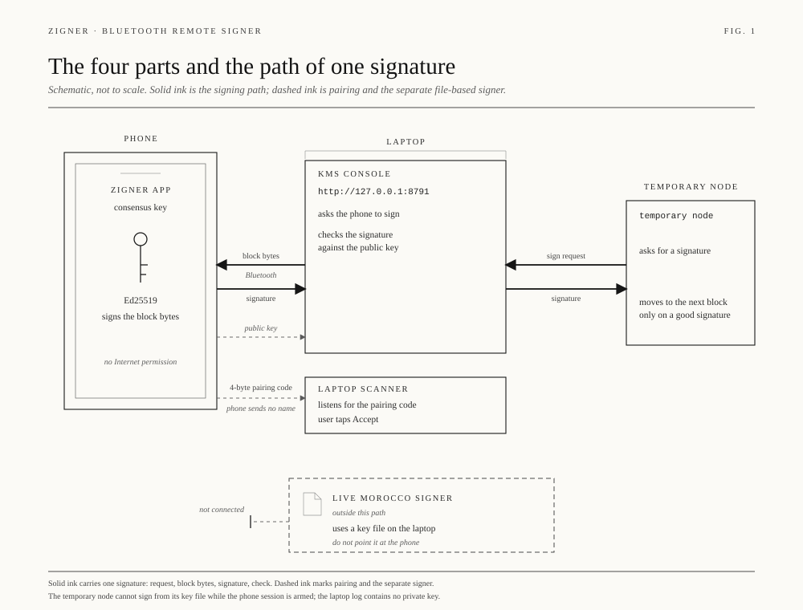
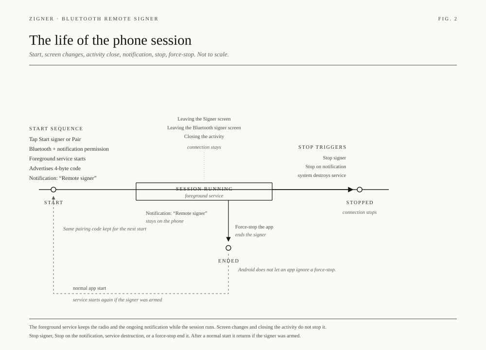
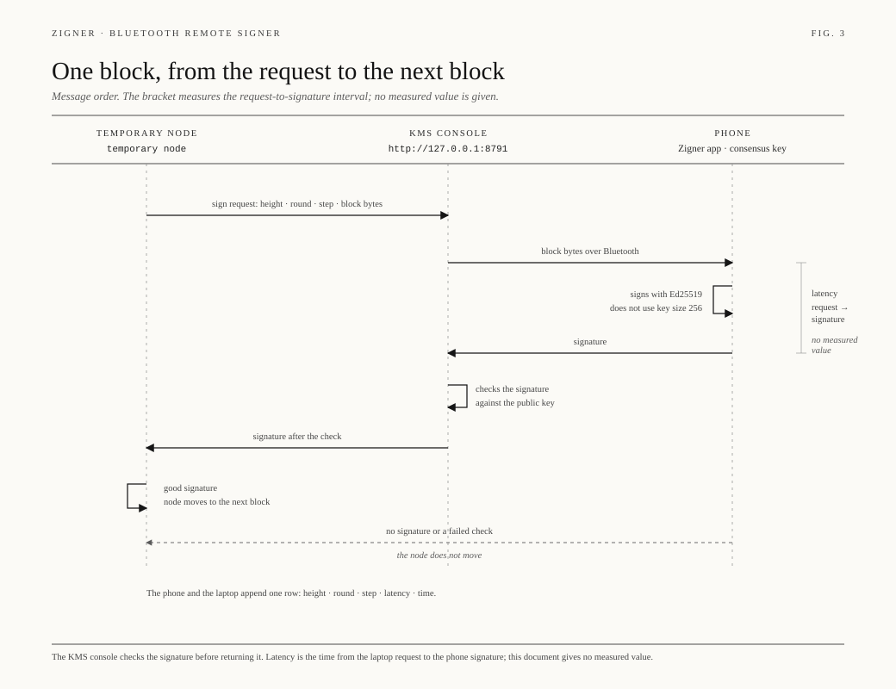
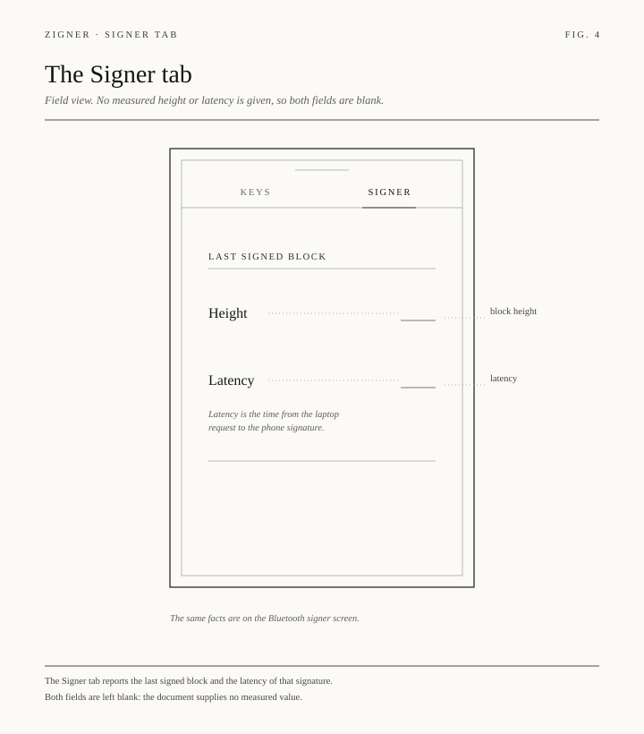

<div align="center">

# Zafu Zigner

**Air-gapped cold wallet for Zcash: turn a spare phone into an offline signer.**

Keys stay on the offline device. Transactions go in and signatures come out as QR codes.
Part of the [Zafu](https://github.com/rotkonetworks/zafu) ecosystem.

[](https://github.com/rotkonetworks/zigner/releases/latest)
[](LICENSE)
[](https://github.com/rotkonetworks/zigner/releases)

</div>

## How it works

1. Pair: export a viewing key from Zigner as a QR and scan it into
   [Zafu](https://github.com/rotkonetworks/zafu) or Zashi. The hot wallet can
   see balances and build transactions, but cannot spend.
2. Sign: the hot wallet shows an unsigned transaction as a QR. Zigner scans
   it, shows recipient, amount and fee, and after you approve, shows the
   signature as a QR.
3. Broadcast: the hot wallet scans the signature back and sends the
   transaction.

The device should never be online after setup. Airplane mode with WiFi,
Bluetooth and NFC off is the minimum. A Pixel 8 or newer running GrapheneOS
is recommended. See [Security and Privacy](docs/src/about/Security-And-Privacy.md).

## Bluetooth consensus signer

zcinti is the optional mode where this phone holds an Ed25519 consensus key and signs blocks for a laptop KMS. It is not the QR air-gap path above. The user starts it from the Signer tab. Stop keeps the phone off the radio until Start is pressed again.

The flows are in [docs/bluetooth-remote-signer.md](docs/bluetooth-remote-signer.md). The stack demo is `docs/stack.html` in the KMS repo.









Open work is in [docs/TODO.md](docs/TODO.md).


## Zcash

- Orchard shielded spends and transparent inputs, signed from a PCZT
  (Keystone-compatible animated UR QR codes).
- Keys: ZIP-32 `m/32'/133'/account'`, with UFVK export (ZIP-316) to Zafu or Zashi.
- The review screen decodes recipients, amounts and fee from the PCZT itself.
  Spends that don't match notes this device has verified get a warning.
  Read the screen before you approve: what you approve is what gets signed.
- FROST threshold multisig for Orchard via [`frost-spend`][frost-spend]: key
  generation and signing run over QR codes, with no server in the
  cryptographic path. Round 2 signs only what you approved in round 1, and
  nonces are never reused.

[frost-spend]: https://github.com/rotkonetworks/zcli/tree/master/crates/frost-spend

## Networks are kept apart

- One seed, separate keys: each network derives its own keys on its own path
  (Zcash `m/32'/133'/…`, Penumbra `m/44'/6532'/…`). A key for one network
  never signs for another.
- Penumbra requests carry a chain ID, which is checked on every signature.
- The camera is the only input. A network's codes are parsed only when the
  device holds a key for that network: a Zcash-only phone never runs the
  Penumbra parser. Other networks' codes are always refused. (Multi-frame
  codes still pass through a shared frame decoder before they are sorted.)

## Penumbra

Signs Penumbra transactions from Zafu or [Prax](https://praxwallet.com).
Exports a full viewing key, and a receive address derived from that same key.

## Building

Requires [Rust](https://www.rust-lang.org/tools/install) and
`cargo install uniffi_bindgen --version 0.22.0`. All cryptography and parsing
live in the Rust core under `rust/`. `android/` and `ios/` hold the native apps.

- Android: `rustup target add aarch64-linux-android armv7-linux-androideabi x86_64-linux-android`,
  then build in [Android Studio](https://developer.android.com/studio) with
  NDK `24.0.8215888`.
- iOS: `ios/` is kept but no longer maintained, untested and not built in CI. It
  lacks the camera filtering, air-gap checks and recent fixes the Android
  app has, and FROST signing is off. Do not use it to hold funds.
- Tests: `cd rust && cargo test --locked`

## Releases and verification

Pushing a `v*` tag builds, signs and publishes the APK with `SHA256SUMS` and
`SHA256SUMS.sig`. Releases are also published to
[our F-Droid repo](https://foss.rotko.net/fdroid/repo).

```
echo 'release@rotko.net ssh-ed25519 AAAAC3NzaC1lZDI1NTE5AAAAILOpUCz+cYuqfvZVBVBTXvUHXD8HZTTyesPqhgOvwQWl' > allowed_signers
ssh-keygen -Y verify -f allowed_signers -I release@rotko.net -n file -s SHA256SUMS.sig < SHA256SUMS
sha256sum -c SHA256SUMS
```

## License

[GPL-3.0](LICENSE)
